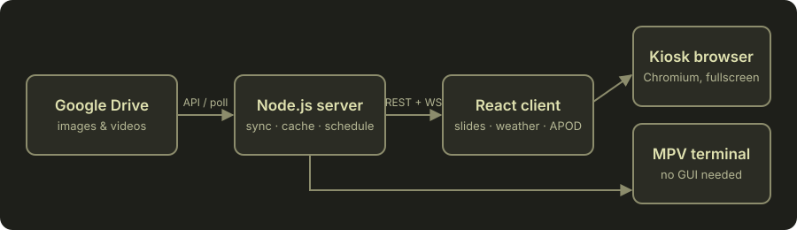

<div align="center">


**Digital signage that runs itself.**
Drop images and videos into a Google Drive folder, and your displays pick them up within seconds.

[](LICENSE)


</div>

## Features

- **Google Drive sync**: images and videos are downloaded and cached; changes show up live over WebSocket.
- **Schedules in filenames**: `notice_15-03@20-03.jpg` only shows on those days.
- **Display schedule**: on/off times, operating weekdays and vacation periods.
- **Dynamic daily view**: day/night transitions, weather, NASA picture of the day, quotes and facts.
- **Kiosk ready**: fullscreen Chromium on a Raspberry Pi, or an MPV terminal mode with no desktop at all.
- **Touch and swipe** navigation, automatic reconnects and health monitoring.

## How it works



## Quick start

**Requirements:** Node.js 24 (20 or newer on a Pi), a Google Cloud project with the Drive API enabled.

```bash
git clone https://github.com/Muddyblack/Terminal-Slide-Show.git
cd Terminal-Slide-Show
npm install && npm install --prefix client && npm install --prefix server

cp server/config/.env.example server/config/.env   # then edit it
npm run dev
```

The client runs on <http://localhost:5173>, the API on port 3000.

### Raspberry Pi fleet

**New here?** Follow the step-by-step guide: [Deutsch](docs/ANLEITUNG.md) or [English](docs/SETUP.md). A wizard (`tools/slideshow-setup`) asks the questions and sets everything up, on Windows (WSL2), macOS and Linux.

For real displays, use the Ansible collection in [`ansible/`](ansible/README.md). It sets up and maintains Raspberry Pi 3, 4 and 5 (Raspberry Pi OS Lite) from an inventory in your own repository: per-site and per-device settings, a hardened and firewalled system, checksum-verified releases, rolling updates with health checks, automatic security updates and an optional daily reboot. Each Pi shows the full daily view in Chromium or plays just the media with MPV, and either can use a central server instead of running its own backend. `tools/slideshow-sdcard` prepares a ready-to-boot SD card in one command: put it in a blank Pi and it sets itself up.

### Docker

```bash
docker compose up -d --build
```

The frontend is served on port 5173 and the backend on 3000. `downloads/` and `server/config/` are mounted into the backend container.

A Nix dev shell is available via `nix develop`.

## Configuration

Secrets and per-machine values live in `server/config/.env`:

| Variable | Purpose |
| --- | --- |
| `GOOGLE_FOLDER_ID` | Drive folder to sync |
| `GOOGLE_SERVICE_ACCOUNT` | Path to the service account JSON key |
| `GOOGLE_API_KEY` | Alternative to the service account (public folders only) |
| `NASA_API_KEY` | Optional, enables the picture of the day |
| `LOCATION` | Name shown on screen and used for the weather |
| `SLIDESHOW_CONFIG` | JSON file with per-device settings, merged over `frontend.config.js` (this is how the Ansible role configures each Pi) |
| `DOWNLOAD_PATH`, `DATA_PATH`, `CLIENT_DIST` | Where media, quotes/facts/greetings and the built frontend live |
| `BACKEND_HOST/PORT`, `FRONTEND_HOST/PORT` | Bind addresses |
| `LOG_LEVEL` | `debug`, `info`, `warn` or `error` |

Behaviour is set in [`server/config/frontend.config.js`](server/config/frontend.config.js):

Besides the schedule, slide duration and media types it covers the **language** (`de` or `en`), **units** (metric or imperial), the **exact position and elevation** for the weather, which daily-view widgets are shown, and the logo. The browser loads these at runtime from `/config.js`, so one build serves many devices. The same keys can be set per device with `SLIDESHOW_CONFIG`.

```js
schedule: {
  enabled: true,
  onTime: '07:35',
  offTime: '19:30',
  days: [1, 2, 3, 4, 5],              // Monday to Friday
  vacationPeriods: [{ start: '24.06.2024', end: '24.07.2024' }],
},
```

### Google Drive access

1. Create a project in the [Google Cloud Console](https://console.cloud.google.com/) and enable the **Drive API**.
2. Pick one:
   - **Service account (recommended):** create one, download the JSON key, share your Drive folder with its email, and set `GOOGLE_SERVICE_ACCOUNT`.
   - **API key:** create a key, make the folder public via link, set `GOOGLE_API_KEY`, and set `useServiceAccount: false` in `server/config/config.js`.
3. Set `GOOGLE_FOLDER_ID` to the ID from the folder URL.

## File naming

Name files in Drive to control when and how long they show:

| Pattern | Meaning |
| --- | --- |
| `name_DD-MM-YYYY.ext` | Single date |
| `name_DD-MM-YYYY@DD-MM-YYYY.ext` | Date range |
| `name_DD-MM@DD-MM.ext` | Date range, every year |
| `name_10s_.ext` | Show for 10 seconds (videos without it play until they end) |
| `name_11h-13h_.ext` | Show only between 11:00 and 13:00 every day |
| `name_8h30-17h45_.ext` | Minutes are optional: 08:30 to 17:45 |

Years may be two digits, and `-`, `.` or `_` work as separators. Duration, time window and dates can be combined. The `_` on both sides of the duration and time window is required. A time window may cross midnight (`22h-2h`), and without a date it applies every day.

```
banner_01-01-2024@31-01-2024.jpg   January 2024 only
event_01-06@15-06.jpg              June 1-15, any year
image_5s_25-12-2024.jpg            works
image5s_25-12-2024.jpg             ignored, missing leading _
lunch_11h-13h_01-06@15-06.jpg      June 1-15, lunchtime only
```

## Displays

Each device runs one of two display modes, chosen per device in the Ansible inventory:

| Mode | Shows | Best for |
| --- | --- | --- |
| `browser` | Chromium in a single-app Wayland compositor: media plus the daily view (clock, weather, NASA picture, quotes) | Pi 4 and 5 |
| `mpv` | Images and videos only, played by MPV | Pi 3, or when you only want plain media |

Outside the schedule the screen shows black. The role can also cut the screen itself (`vcgencmd`, `wlr-randr`, HDMI-CEC or your own command), which depends on the display and needs testing on real hardware; see the [fleet documentation](ansible/README.md#switching-the-screen-off).

## API

| Endpoint | Description |
| --- | --- |
| `GET /api/all-media` | Current media list |
| `GET /api/server-status` | Whether the backend is ready |
| `GET /api/display-state` | `{ "active": true }` when the schedule says the display should be on |
| `GET /config.js` | Per-device settings for the browser |
| `GET /api/quotes`, `/facts`, `/greetings` | Daily view content |
| `GET /api/weather`, `/nasa-apod` | Weather and picture of the day |
| `WS /ws` | Live media, schedule and health updates |

## Contributing

See [CONTRIBUTING.md](CONTRIBUTING.md).

## License

[GPL-3.0](LICENSE)
